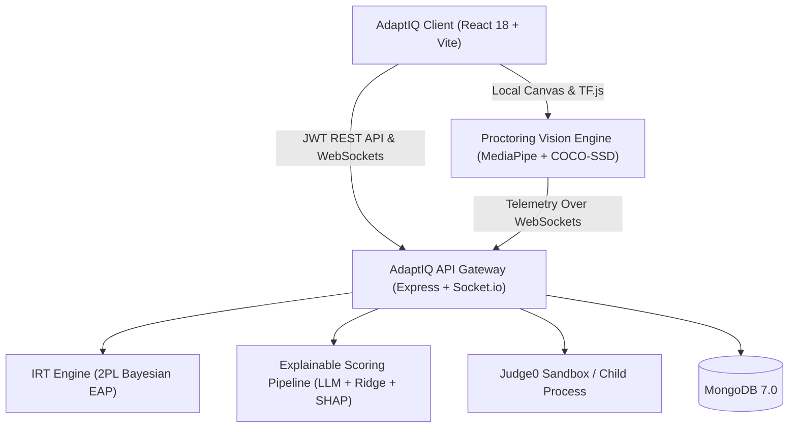

# AdaptIQ - AI-Powered Adaptive Interview & Skill Intelligence Platform

> **Production-Style MERN Platform with Item Response Theory (IRT), Explainable AI (XAI), Algorithmic Fairness & EEOC Audit, Skill-Gap Graphology, Real Computer Vision Proctoring, and Sandboxed Code Execution.**

[](https://nodejs.org/)
[](https://react.dev/)
[](https://expressjs.com/)
[](https://www.mongodb.com/)
[](https://vitejs.dev/)
[](https://jestjs.io/)
[](https://playwright.dev/)
[](LICENSE)

---

## ⚡ 5-Minute "Run It" Guide (Fresh Machine)

Follow these steps to run the complete AdaptIQ application with fully populated demo data in under 5 minutes:

### 1. Prerequisites
- **Node.js**: v20+ LTS installed
- **MongoDB**: Local MongoDB on `mongodb://localhost:27017` or MongoDB Atlas URI (or tests run in-memory via `mongodb-memory-server`)

### 2. Clone & Install
```bash
git clone https://github.com/adaptiq/adaptiq.git
cd adaptiq

# Install root, client, and server dependencies
npm install
```

### 3. Setup Environment Variables
```bash
cp server/.env.example server/.env
```
*(Optionally set `GEMINI_API_KEY` for live AI rubric scoring, or leave blank to test the offline heuristic model).*

### 4. Seed Demo Data
Populates demo users, 12 completed sessions with realistic $\theta$ trajectories, SHAP feedback, learning roadmaps, red alerts, and review queues:
```bash
npm run seed:demo
```

### 5. Start Application
```bash
npm run dev
```
- **Frontend App**: [http://localhost:5173](http://localhost:5173)
- **Backend API**: [http://localhost:5000](http://localhost:5000)

### 6. Quick Demo Logins
| Role | Email | Password | What to explore |
| :--- | :--- | :--- | :--- |
| **Candidate** | `candidate@adaptiq.ai` | `Candidate@123456` | Active session resume, practice mode, skill graph DAG, plain-English roadmap |
| **Recruiter** | `recruiter@adaptiq.ai` | `Recruiter@123456` | Live proctoring monitor, candidate radar comparison, red alert injection |
| **Admin** | `admin@adaptiq.ai` | `Admin@123456` | AI question approval queue, IRT recalibration, EEOC fairness dashboard |

### 7. Run Test Suites
```bash
# Client Component & UI Tests (Vitest)
npm run client:test

# Server Unit & ML Tests (Jest)
npm run server:test

# Playwright End-to-End Tests
npm run e2e
```

---

## 📊 Honest Feature & Dependency Matrix

| Feature | Subsystem | Status | Requirements | Offline Graceful Fallback |
| :--- | :--- | :---: | :--- | :--- |
| **Adaptive IRT Engine** | 2PL Logistic Model + Bayesian EAP + Fisher Information | ✅ Working | Working (Local) | Fully local mathematical solver |
| **Honest AI Scorer** | 5-dimension rubric scoring | ✅ Working | Needs API Key (`GEMINI_API_KEY`) | Calibrated local ridge regression heuristic (`evaluatedBy: heuristic`, confidence capped at 0.40) |
| **Explainable SHAP** | Dimension feature attribution & counterfactuals | ✅ Working | Working (Local) | Exact Linear SHAP attribution: $\sum \phi_i = f(x) - E[f(x)]$ |
| **Real Computer Vision** | MediaPipe FaceLandmarker, iris gaze, COCO-SSD, face-api | ✅ Working | Needs Camera | Uses local models served from `client/public/models/` without CDN |
| **Code Execution** | Sandboxed runner (JS/Python/Java/C++) | ✅ Working | Working (Local Dev) / Needs Key (Judge0) | Process-isolated child runner for JS (`ALLOW_UNSAFE_LOCAL_EXEC=true`); HTTP 503 for Judge0 offline |
| **Skill-Gap Taxonomy** | 84-node DAG + prerequisite back-propagation | ✅ Working | Working (Local) | Graphology in-memory directed graph |
| **Candidate Leaderboard** | Calibrated trait ranking with opt-in toggle | ✅ Working | Working (Local) | Persistent opt-in toggle stored in database |
| **Speech Telemetry** | Acoustic metrics (WPM, filler ratio, pace) | ✅ Working | Needs Mic / API Key | Browser MediaRecorder + Whisper API |
| **Algorithmic Fairness** | EEOC Four-Fifths rule, DIF, effect sizes | ✅ Working | Working (Local) | Confidential isolated demographic collection |
| **Executive PDF Export** | High-resolution candidate performance report | ✅ Working | Working (Local) | Puppeteer headless Chromium with printable HTML stream fallback |

---

## ⚠️ Known Limitations & Design Boundaries

1. **Facial Emotion Recognition is Deliberately Excluded**:
   - Scientific literature and EEOC regulations establish that facial micro-expressions do not correlate with technical competency and produce disparate impact against neurodivergent candidates. AdaptIQ scores **only** answer substance, code correctness, and acoustic clarity.
2. **Offline Heuristic Estimate Disclosures**:
   - When `GEMINI_API_KEY` is not present, the system refuses to invent "fake AI scores". Instead, it explicitly marks evaluations with an **"Offline estimate (not AI-evaluated)"** badge, caps confidence at 0.40, and disallows certified report generation until reviewed by a human recruiter.
3. **Camera & Lighting Constraints**:
   - Vision proctoring requires minimum ambient illumination (>= 35 luminance) and standard 720p webcams. Practice mode allows candidates to bypass all proctoring checks entirely to practice in a private sandbox.
4. **Code Execution Isolation**:
   - In production environments, code execution requires self-hosted Judge0 CE or RapidAPI hosted Judge0. The child-process fallback is strictly restricted to JavaScript in non-production environments with network blocking.

---

## 🏛 System Architecture Overview



Detailed architectural diagrams, sequence flows, and sub-systems are documented in [docs/ARCHITECTURE.md](file:///C:/Users/Ashish%20Yadav/.gemini/antigravity/scratch/adaptiq/docs/ARCHITECTURE.md).

---

## 🎓 Viva & Technical Defense Guide

Comprehensive viva defense materials, examiner question breakdowns, and live demonstration scripts are documented in [docs/VIVA.md](file:///C:/Users/Ashish%20Yadav/.gemini/antigravity/scratch/adaptiq/docs/VIVA.md).
