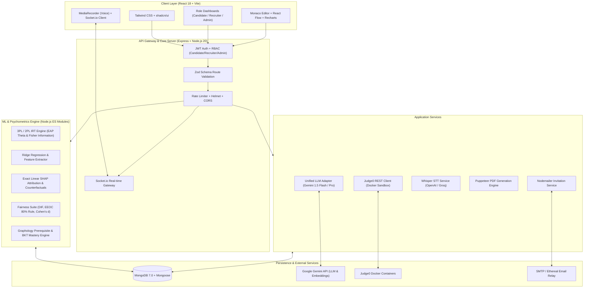
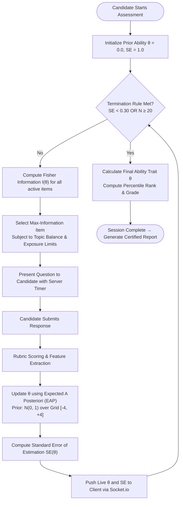
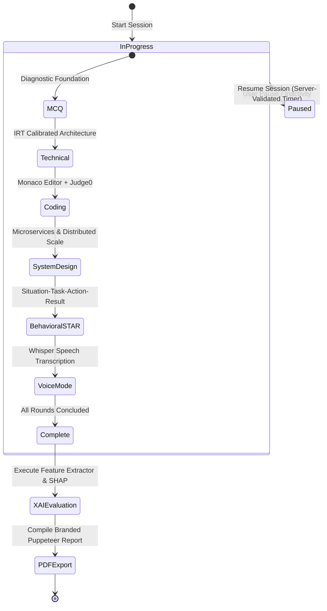
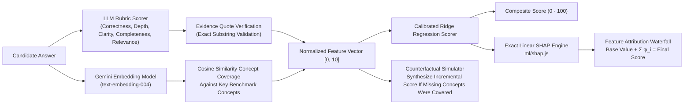
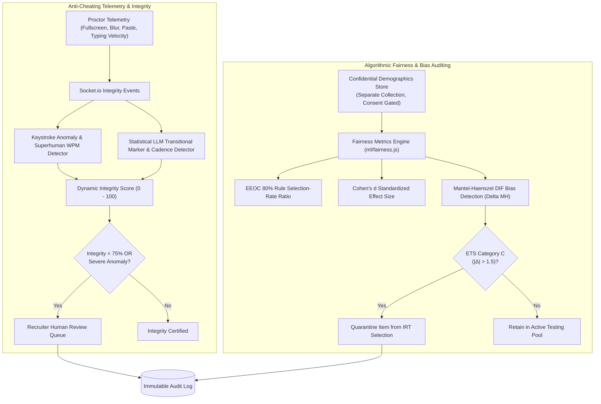

# AdaptIQ Enterprise System Architecture & Engine Specifications

AdaptIQ is an enterprise-grade AI-powered adaptive interview and psychometric skill assessment platform built entirely on the MERN stack with modern ES modules (Node.js 20). It delivers mathematical rigor, explainable scoring, proctored trust, and algorithmic fairness without requiring a Python runtime.

---

## 1. High-Level System Architecture

---

## 2. Psychometric 2PL/3PL IRT Adaptive Engine

The adaptive interview engine implements Item Response Theory (IRT) with a three-parameter logistic (3PL) model:

$$P(\theta) = c + \frac{1 - c}{1 + e^{-a(\theta - b)}}$$

Where:
- $\theta$: Candidate latent ability parameter ($\theta \in [-4.0, +4.0]$).
- $a$: Item discrimination parameter ($a > 0$).
- $b$: Item difficulty parameter ($b \in [-3.0, +3.0]$).
- $c$: Pseudo-guessing pseudo-chance parameter ($0 \le c < 1$, defaults to $0$ in 2PL mode).

---

## 3. Multi-Round Assessment State Machine

AdaptIQ dynamically tailors assessments across 6 distinct round types per role track:

---

## 4. Explainable AI (XAI) Scoring & SHAP Feature Attribution

---

## 5. Fairness, Trust & Anti-Cheating Architecture

