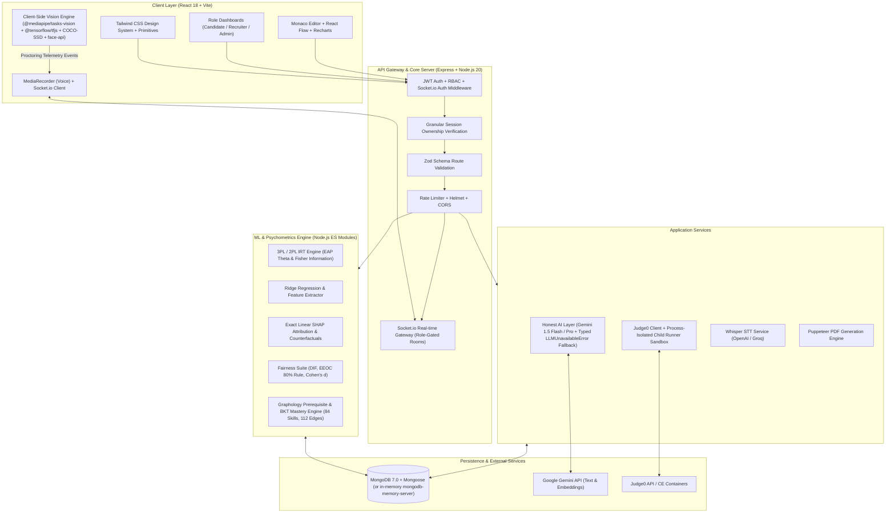
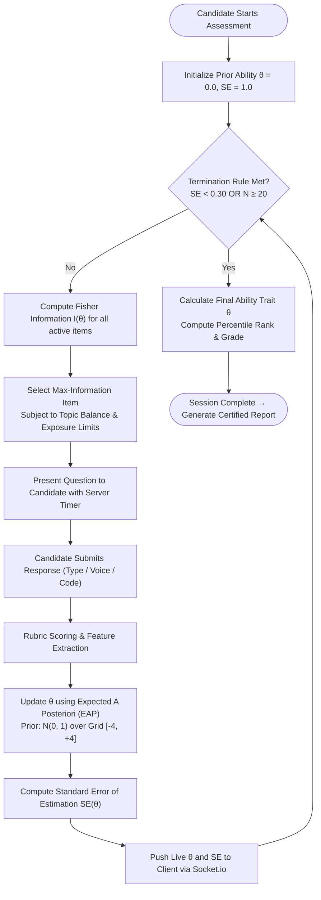
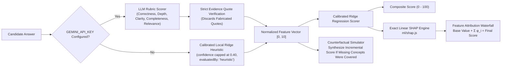
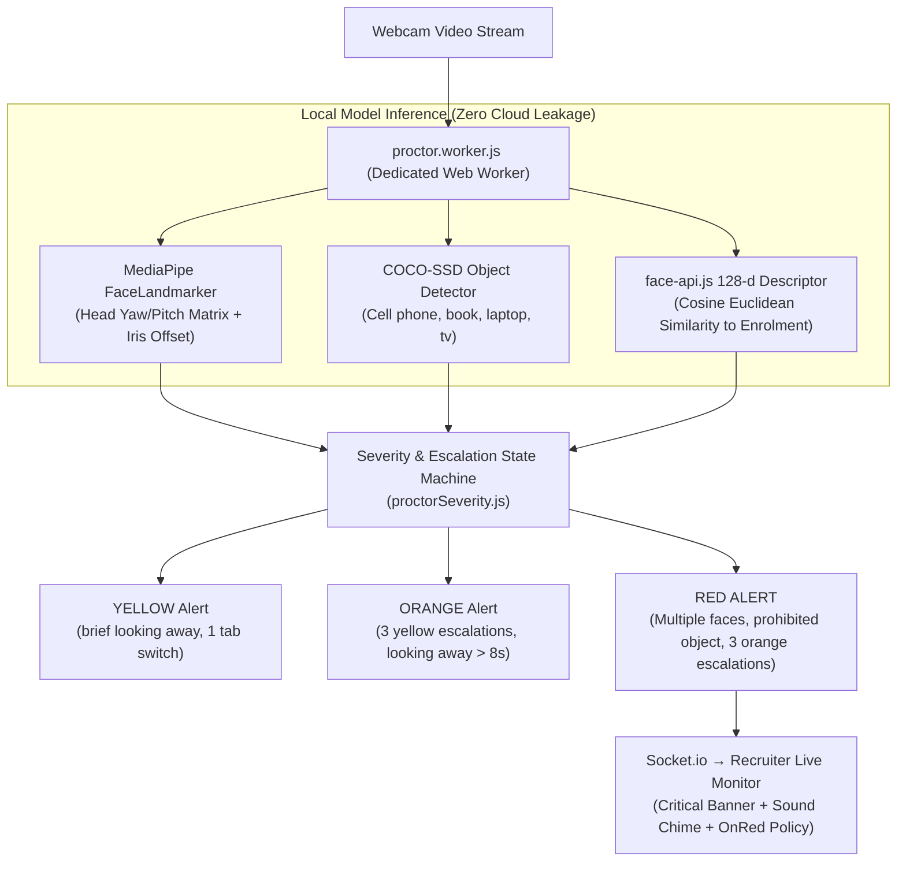
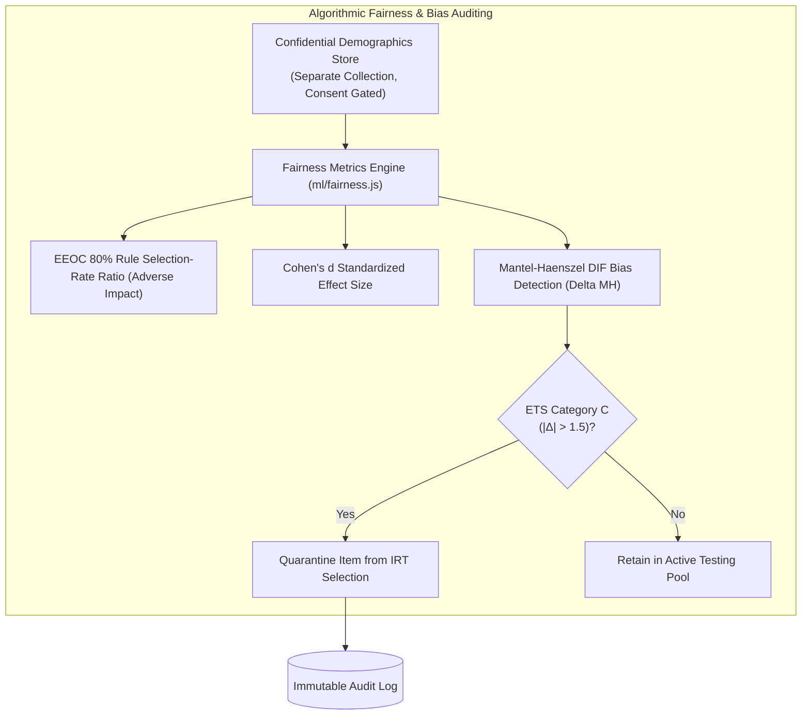

# AdaptIQ Enterprise System Architecture & Engine Specifications

AdaptIQ is an enterprise-grade AI-powered adaptive interview and psychometric skill intelligence platform built entirely on the MERN stack with modern ES modules (Node.js 20). It delivers mathematical rigor, explainable scoring, real computer vision proctoring, and algorithmic fairness without requiring external Python environments.

---

## 1. High-Level System Architecture

---

## 2. Psychometric 2PL/3PL IRT Adaptive Engine

The adaptive interview engine implements Item Response Theory (IRT) with a two- and three-parameter logistic model:

$$P(\theta) = c + \frac{1 - c}{1 + e^{-a(\theta - b)}}$$

Where:
- $\theta$: Candidate latent ability parameter ($\theta \in [-4.0, +4.0]$).
- $a$: Item discrimination parameter ($a > 0$).
- $b$: Item difficulty parameter ($b \in [-3.0, +3.0]$).
- $c$: Pseudo-guessing parameter ($0 \le c < 1$, defaults to $0$ in 2PL mode).

---

## 3. Honest AI Scoring & SHAP Feature Attribution

---

## 4. Real Computer Vision Proctoring Pipeline

Proctoring executes on-device computer vision inside client Web Workers with no raw video transmission:

---

## 5. Algorithmic Fairness & EEOC Audit Architecture

